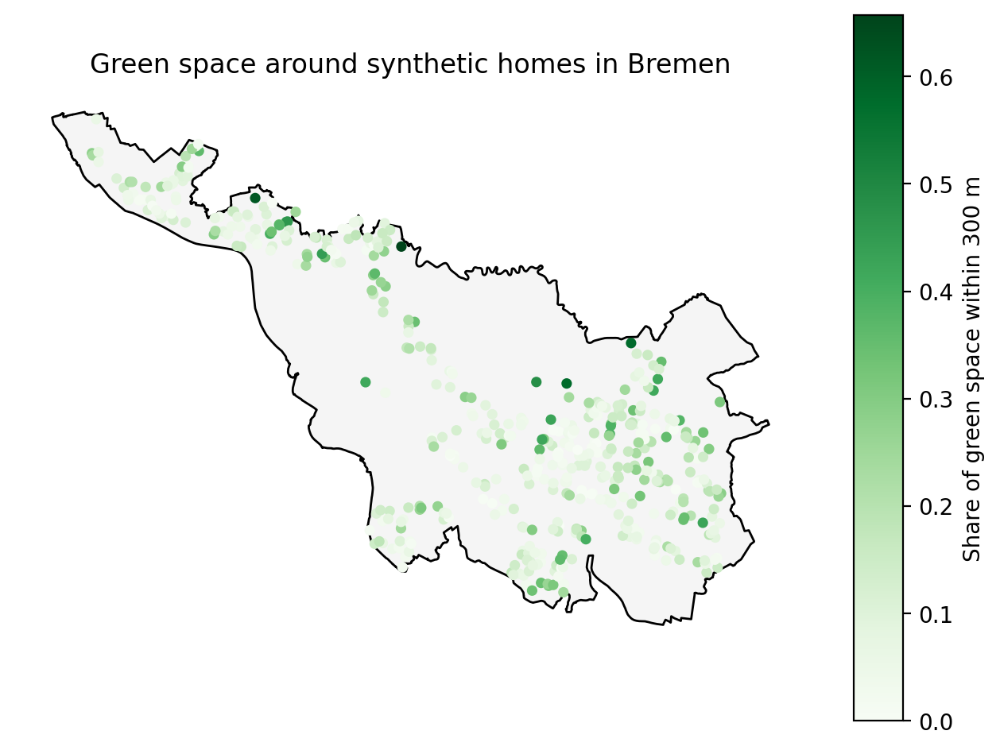

# Environmental exposure linkage for residential locations (Bremen demo)

A reproducible Python pipeline that links environmental exposures to residential locations and stores them as a documented, quality-checked exposure database. It demonstrates the workflow used to enrich cohort data with environmental exposures, applied here to **500 synthetic home locations in Bremen, Germany**.



## Research context

Where children live shapes their exposure to green and blue space, heat and air pollution, and these exposures are often unequally distributed by social position. This project builds the data foundation for such questions: linking open environmental data to residential locations in a way that is transparent, reproducible and easy to extend.

## Files

| File | Content |
|---|---|
| `01_locations_and_data.ipynb` | Creates 500 synthetic homes within OpenStreetMap residential areas of Bremen and downloads green and blue spaces |
| `02_exposure_database.ipynb` | Computes exposures from the configuration file, generates the data dictionary and runs quality checks |
| `exposures.yaml` | Configuration file defining every exposure variable |
| `exposures.py` | Reusable linkage code that reads the configuration |
| `homes_exposures.csv` | Resulting exposure database (500 homes × 7 variables) |
| `data_dictionary.csv` | Automatically generated variable documentation |
| `quality_report.csv` | Automatically generated quality checks |

**Current exposure variables (7):**

| Variable | Description |
|---|---|
| `green_share_100m`, `_300m`, `_500m` | Share of the buffer area covered by green space |
| `blue_share_300m`, `_500m` | Share of the buffer area covered by water |
| `dist_green_m` | Distance to the nearest green space (metres) |
| `dist_blue_m` | Distance to the nearest water body or river (metres) |

## Designed to be extended

All exposures are defined in [`exposures.yaml`](exposures.yaml). To add a new variable, add an entry like this and rerun notebook 02:

```yaml
  - name: blue_share
    description: Share of buffer area covered by water bodies
    method: area_share
    source_file: data/raw/osm_blue.gpkg
    source: OpenStreetMap (accessed October 2026)
    buffers_m: [300, 500]
    unit: proportion (0-1)
    valid_range: [0, 1]
```

The linkage code ([`exposures.py`](exposures.py)) reads the configuration and calculates every listed variable. The data dictionary and quality report update automatically.

## Quality checks

Each run checks missing values, values outside plausible ranges, duplicate IDs and the coordinate reference system. Current result: **all checks passed** (500 homes, 7 variables, no missing or out-of-range values). See [`quality_report.csv`](quality_report.csv).

## Key methodological choices

- **Coordinate reference system:** all data are projected to ETRS89 / UTM zone 32N (EPSG:25832), so buffers and distances are in metres.
- **Realistic locations:** homes are sampled only within residential land-use areas, excluding parks, farmland, water and industrial zones. The port exclave in Bremerhaven, which belongs to the city of Bremen but contains no residential areas, is excluded.
- **No double counting:** overlapping green areas (for example grass inside a park) are merged before area shares are computed.
- **Buffer sizes:** 100, 300 and 500 m, in line with common practice in greenspace and health research (Markevych et al., 2017, *Environmental Research*).
- **Performance:** spatial indexing and 1 m geometry simplification keep calculations fast enough to scale to large cohorts.

## Data and privacy

- **Environmental data:** © OpenStreetMap contributors, available under the Open Database License (ODbL).
- **Home locations are synthetic** (random points within residential areas, seed 42). Real cohort addresses are personal data and are never published.

## Limitations and next steps

- OpenStreetMap tagging is incomplete in places, and what counts as "green" is a definitional choice. Next step: add satellite-derived greenness (NDVI) and land surface temperature to compare with map-based measures.
- Residential exposure ignores time spent at school or elsewhere.
- With real cohort data, exposures would be matched in time to each examination wave, and residential histories would account for moves.
- Next step: a simulated association analysis of exposures, household deprivation and child health outcomes, including effect modification by social position.

## Author

**Alokita Jha** · Climate, environment and health researcher · Berlin
